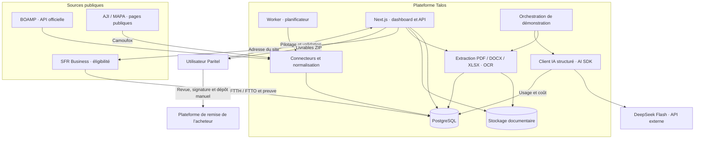
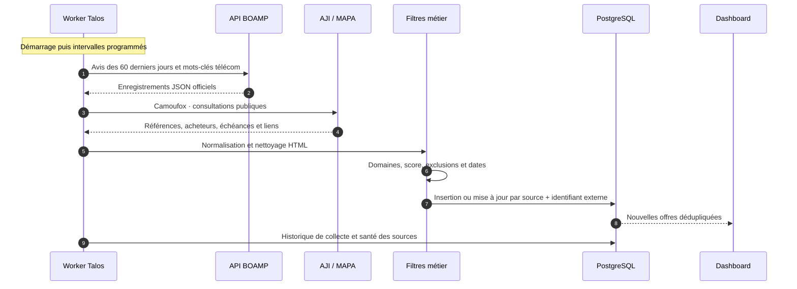
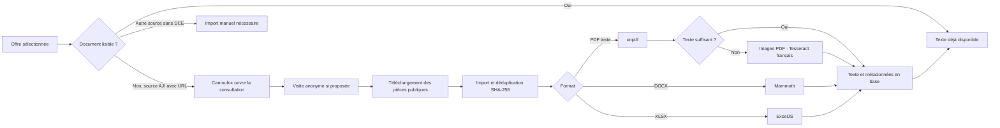
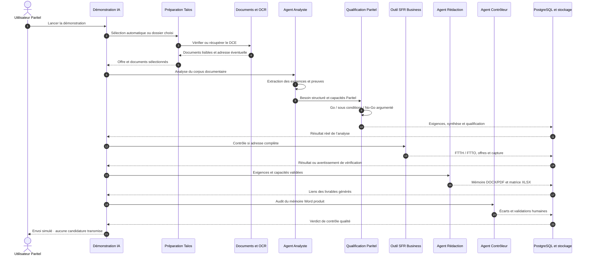
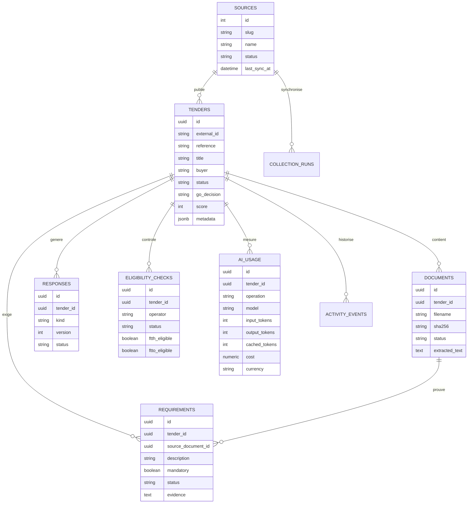
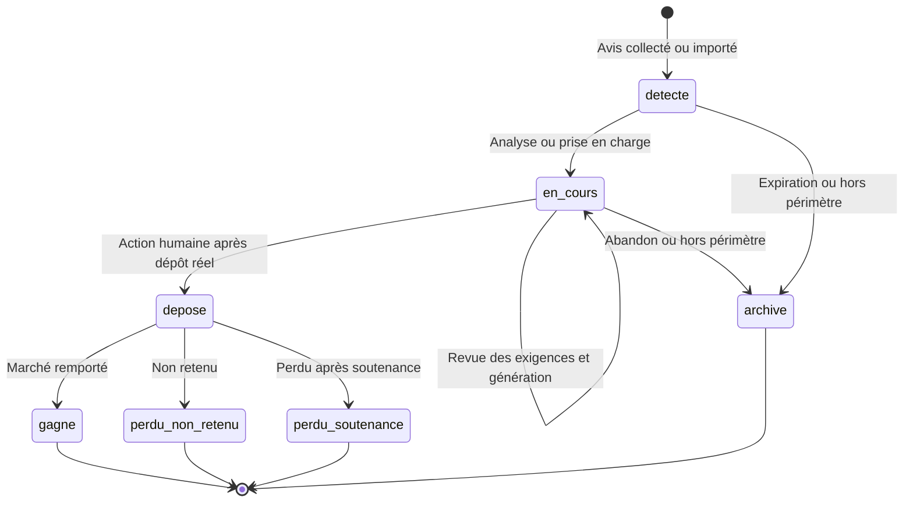
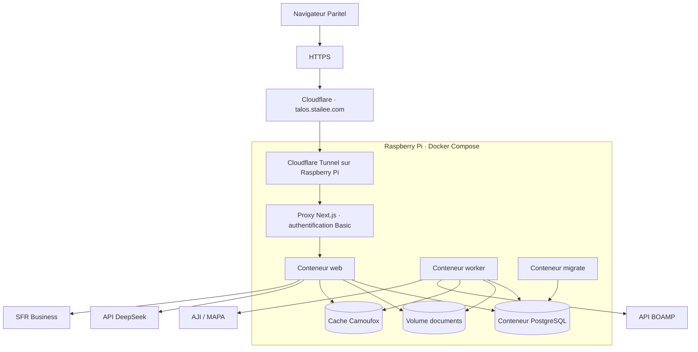
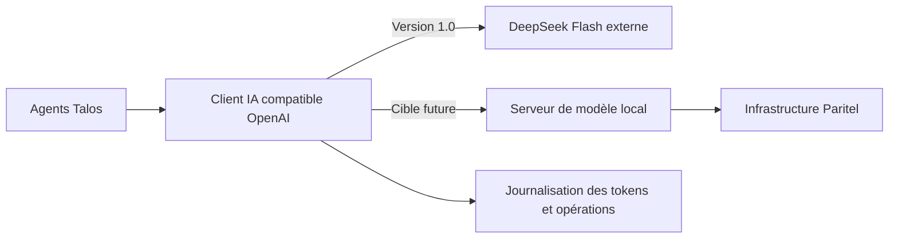

# Architecture de Talos · version 1.0

Ce document décrit l’architecture réellement déployée. Il distingue les automatisations déterministes, les appels IA et les validations humaines.

## 1. Principes de conception

- **Des connecteurs déterministes pour collecter** : une API officielle ou un navigateur automatisé est plus fiable qu’un LLM pour extraire des pages structurées.
- **Des agents IA pour interpréter et rédiger** : l’analyse, la qualification et le contrôle qualité utilisent des sorties JSON validées par des schémas Zod.
- **Des preuves plutôt que des affirmations** : les exigences conservent un extrait du document source et restent soumises à revue.
- **Une validation humaine avant engagement** : prix, capacités non validées, signature et dépôt ne sont pas automatisés.
- **Une mesure de chaque appel IA** : modèle, opération, tokens, cache, coût estimé et devise sont enregistrés.

## 2. Vue d’ensemble

Le scraping et l’IA sont donc deux couches distinctes. Camoufox exécute des scénarios navigateur ; il ne constitue pas un agent IA.

## 3. Collecte et scraping

### Planification

Le worker démarre une collecte au lancement, puis applique les intervalles suivants :

- BOAMP : toutes les **15 minutes** ;
- AJI : toutes les **60 minutes** ;
- un verrou par source évite deux exécutions simultanées ;
- chaque exécution produit une ligne `collection_runs`, y compris en cas d’erreur.

### Règles de normalisation

Chaque connecteur transforme son avis dans une structure commune :

- identifiant externe et référence ;
- titre, acheteur, ville et département ;
- description et domaines ;
- URL officielle ;
- dates de publication et de remise ;
- score de pertinence et métadonnées propres à la source.

La contrainte `(source_id, external_id)` évite les doublons. Une nouvelle collecte met donc à jour l’avis existant au lieu de le recréer.

### Récupération du DCE

La collecte initiale privilégie les métadonnées de l’avis. Le DCE est récupéré à la demande ou au début de la démonstration :

Un document déjà présent mais précédemment en erreur peut être réanalysé sans être téléchargé une seconde fois.

## 4. Chaîne agentique de la démonstration IA

La page `Démonstration IA` pilote de vrais appels HTTP. Chaque étape visuelle ne change d’état qu’après le retour effectif de l’outil ou de l’API concernée.

### Responsabilités des agents

| Composant | Intervention | Limite volontaire |
|---|---|---|
| Orchestrateur | Sélectionne un dossier exploitable et appelle les outils dans l’ordre. | Ne choisit pas seul de déposer. |
| Agent Analyste | Résume le DCE et extrait les exigences avec preuves. | Ne doit inventer aucune exigence. |
| Qualification Paritel | Compare les besoins aux capacités connues et à leur statut de validation. | Une capacité non validée ne devient pas une promesse. |
| Outil SFR | Contrôle l’éligibilité avec un navigateur automatisé. | Ce n’est pas un LLM ; une adresse complète est nécessaire. |
| Agent Rédaction | Produit les sections du mémoire et alimente les livrables. | Aucun prix ni capacité non fournie. |
| Agent Contrôleur | Relit le mémoire Word et signale les écarts. | Ne marque pas le dossier comme déposé. |
| Utilisateur Paritel | Relit, corrige, valide, signe et dépose. | Décision finale obligatoire. |

### Robustesse des appels IA

Le client `src/modules/ai/client.ts` :

- utilise un fournisseur compatible OpenAI ;
- transmet le schéma JSON attendu dans la consigne ;
- valide la réponse avec Zod ;
- désactive le mode réflexion DeepSeek pour la démonstration afin de limiter latence et consommation ;
- limite la taille des corpus et le nombre de tokens de sortie ;
- enregistre les tokens lus en cache avec leur tarif propre ;
- journalise également les appels ayant consommé des tokens avant une erreur de validation.

## 5. Modèle de données

Les documents et réponses sont conservés sur le stockage persistant ; PostgreSQL conserve leurs métadonnées et leurs relations. Les versions de réponses sont incrémentées par AO.

## 6. Cycle de vie d’un appel d’offres

La démonstration IA ne réalise pas la transition `depose`. Cette transition appartient à l’utilisateur après une remise effective.

## 7. Déploiement actuel

### Services Docker

| Service | Rôle |
|---|---|
| `db` | PostgreSQL 18 avec volume persistant et healthcheck. |
| `migrate` | Applique les migrations avant le démarrage du web. |
| `web` | Dashboard, routes API, IA, documents et éligibilité. |
| `worker` | Planification BOAMP/AJI, activé avec le profil `workers`. |

### Volumes

- `talos-db` : données PostgreSQL ;
- `talos-storage` : DCE, réponses et preuves d’éligibilité ;
- `talos-camoufox` : cache du navigateur.

Les secrets sont fournis par `.env` sur le serveur, lu par Docker Compose, et ne sont pas copiés dans Git.

## 8. Correspondance avec le code

| Responsabilité | Emplacement |
|---|---|
| Planification | `src/workers/scheduler.ts` |
| API BOAMP | `src/modules/connectors/boamp.ts` |
| Navigateur AJI | `src/modules/connectors/aji.ts` |
| Score et exclusions | `src/modules/connectors/relevance.ts` |
| Récupération du DCE | `src/modules/documents/retrieve.ts` |
| Extraction et OCR | `src/modules/documents/extract.ts`, `src/modules/documents/ocr.ts` |
| Analyse et qualification | `src/modules/analysis/analyze.ts` |
| Client IA et usage | `src/modules/ai/client.ts` |
| Préparation de la démo | `src/modules/demo/prepare.ts` |
| Audit de la réponse | `src/modules/demo/audit.ts` |
| Génération des livrables | `src/modules/generation/generate.ts` |
| Éligibilité SFR | `src/modules/eligibility/sfr.ts` |
| Interface de démonstration | `src/components/demo-runner.tsx` |
| Authentification | `src/proxy.ts` |

## 9. Sécurité et confidentialité

- L’accès distant est protégé par authentification Basic derrière HTTPS.
- Les fichiers `.env` et les documents internes sont exclus de Git et du contexte Docker.
- GitHub Secret Scanning et Push Protection doivent rester actifs.
- La démonstration actuelle transmet des **documents publics** à DeepSeek ; une API externe ne doit pas recevoir de données internes sans autorisation.
- Les prix, documents clients, mots de passe et tokens d’infrastructure ne font pas partie du dépôt.
- La génération d’un document ne vaut ni validation juridique ni engagement commercial.

## 10. Évolution vers une IA locale

Le client IA étant compatible OpenAI, une cible locale peut remplacer DeepSeek en changeant la configuration du fournisseur, sous réserve de supporter les sorties JSON structurées et la taille de contexte nécessaire.

Le passage au local devra être validé par des mesures comparables : exactitude des exigences, validité des preuves, taux d’hallucination, latence, mémoire vidéo et coût par dossier. L’investissement matériel ne doit pas être déduit de la seule démonstration externe.
